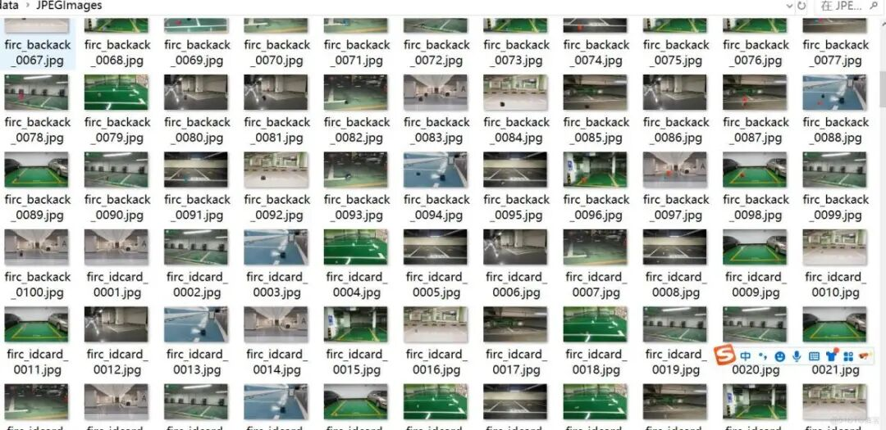
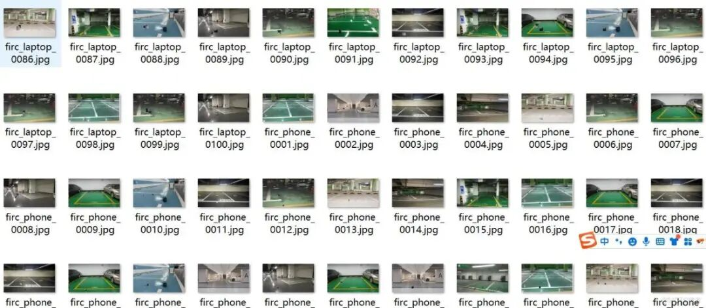
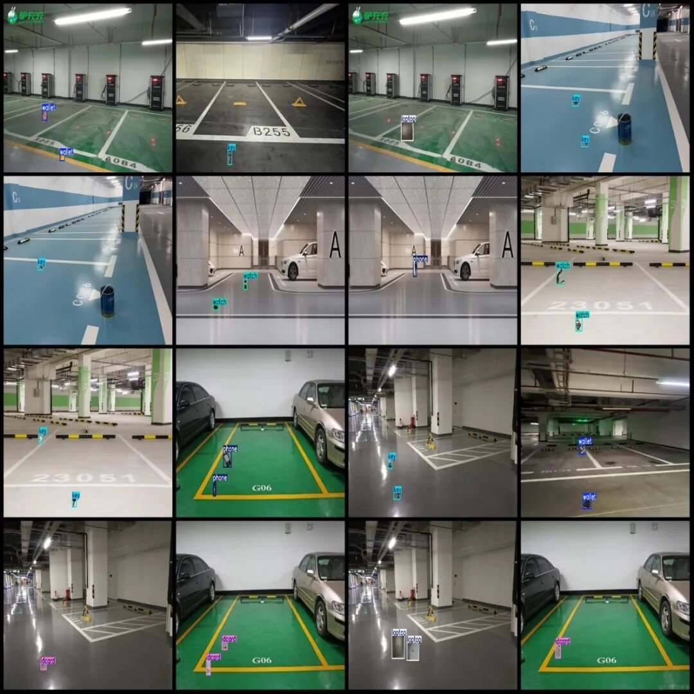
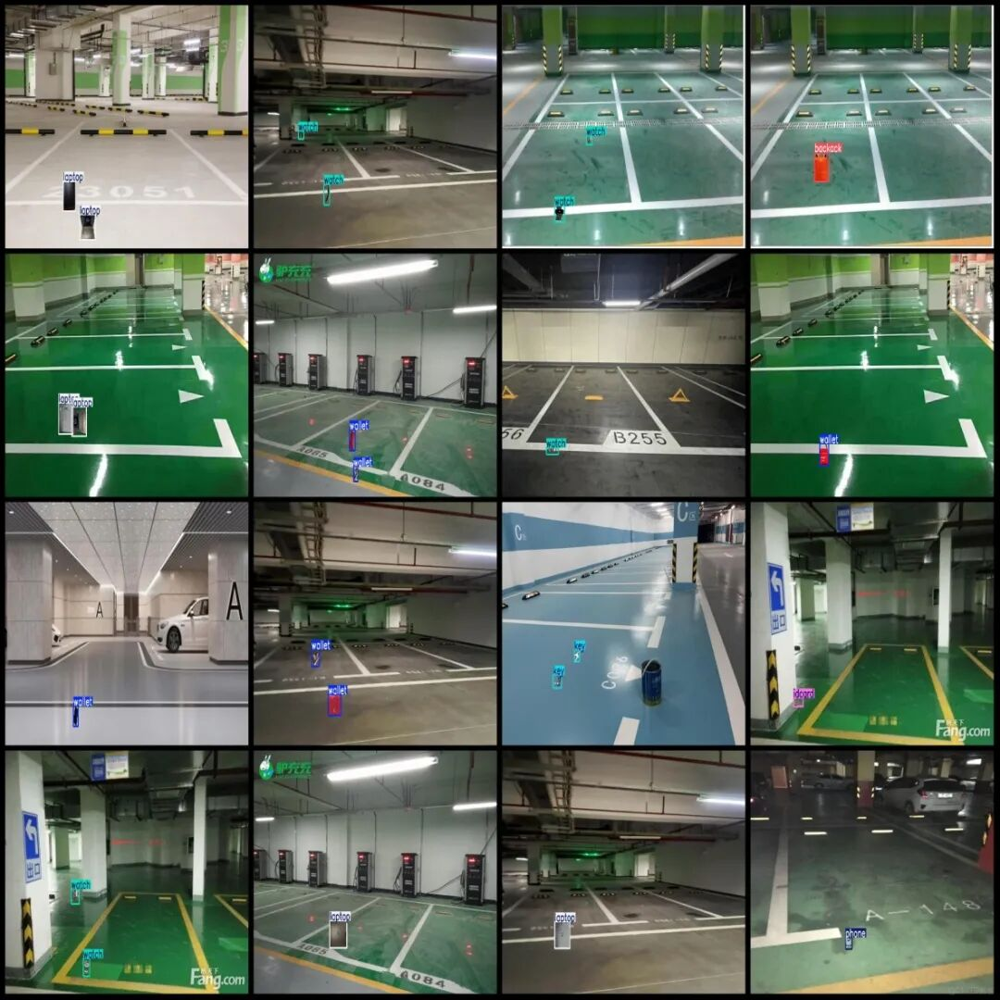

# Detection Dataset for Lost Objects at Underground Parking Spaces in VOC+YOLO format with 7 categories

Dataset format: Pascal VOC format + YOLO format (txt file without split path, only containing jpg images and corresponding VOC format xml files and yolo format txt files)

Number of images (number of jpg files): 700

Number of annotations (number of xml files): 700

Number of annotations (number of txt files): 700

Label category count: 7

Label category names (note that the order of categories in the YOLO format does not correspond to this, but is based on the labels folder's classes.txt): ["backack", "idcard", "key", "laptop", "phone", "wallet", "watch"]

Number of boxes labeled in each category:

Backpack (backack) frame count = 151

ID card (ID card) frame count = 148

Key (key) frame count = 149

Laptop (laptop) Frame Count = 151

Phone (mobile phone) Frame Count = 145

Number of frames for wallet (wallet) = 152

Watch (watch) Frame Count = 153

Total frames: 1049

Image resolution: 1920x1080

Using labelImg:

Annotation rules: Draw a rectangle around the category.

Important Notice: No

Special : This dataset does not guarantee the accuracy of the trained models or weight files.

Image Preview:

Annotation example:

## Payment

Here is a pay link on Stripe ( https://buy.stripe.com/3cs8yP7sY87d0vu9AB ). Please contact me lonlonago@foxmail.com after funding $89, and I will send you a complete data files , thank you!

